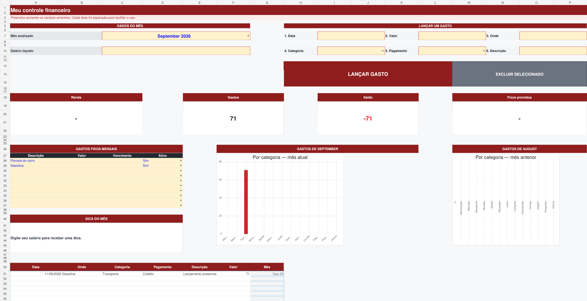

# Meu Gasto IA — versão Excel

Controle financeiro pessoal feito em Excel, pensado para funcionar sozinho e ser simples de usar.



## Baixar e usar

O arquivo pronto está em [`excel/Controle_Gastos_Automatico.xlsm`](excel/Controle_Gastos_Automatico.xlsm).

1. Baixe o arquivo `.xlsm`.
2. Abra pelo Excel para computador.
3. Se o Excel solicitar, habilite as macros do arquivo.
4. Preencha apenas os campos amarelos.

## Funcionalidades

- Cadastro rápido de gastos.
- Exclusão de lançamentos feitos por engano.
- Salário, gastos, saldo e despesas fixas calculados automaticamente.
- Gráficos separados do mês atual e do mês anterior.
- Controle de parcela do carro e gasolina.
- Histórico com até 500 lançamentos.
- Uma única aba visível para facilitar o uso.

## Estrutura

- `excel/`: versão pronta para utilização.
- `src/build.mjs`: criação da planilha, fórmulas, visual e gráficos.
- `src/build_xlsm.py`: inclusão das macros e preparação do `.xlsm`.
- `src/cfb_vba.py` e `src/template.bin`: suporte à montagem do projeto VBA.
- `docs/preview.png`: imagem de demonstração.

## Desenvolvimento

Execute os comandos a partir da raiz do repositório:

```bash
node src/build.mjs
python3 src/build_xlsm.py
python3 src/validate_xlsm.py
```

O primeiro comando gera `build/Controle_Gastos_Automatico.xlsx`. Ele requer Node.js e o pacote privado `@oai/artifact-tool`, que precisa estar disponível no ambiente de geração. O segundo comando inclui as macros e cria a versão final em `excel/`. O terceiro verifica a integridade do arquivo, as fórmulas, a visibilidade das abas, os botões e as macros.

O caminho dos arquivos é calculado a partir da localização dos scripts, portanto os comandos funcionam mesmo quando o repositório estiver em outra pasta.

## Painel web

O painel em [`web/index.html`](web/index.html) funciona sem servidor e pode ser aberto diretamente no navegador. Ele mostra entradas, gastos, saldo, categorias e histórico com filtros.

Depois de atualizar a planilha, gere novamente o painel com:

```bash
python3 src/build_dashboard.py
```

O valor da renda de cada mês pode ser ajustado no próprio painel e fica salvo no navegador utilizado.

Para usar também a aba **Lançar gasto** e gravar diretamente no Excel, execute:

```bash
python3 src/dashboard_server.py
```

Depois abra `http://127.0.0.1:8765`. Cada novo gasto é salvo na planilha, validado e exibido no dashboard automaticamente. O Excel não precisa ficar aberto.

No Windows, basta dar dois cliques em `INICIAR_PAINEL.bat`. O servidor e o endereço correto serão abertos automaticamente. Não abra `web/index.html` diretamente para lançar gastos, pois páginas abertas como arquivo não têm permissão para alterar a planilha.

O dashboard controla separadamente a renda em dinheiro e o crédito do voucher. Selecione `Voucher` como forma de pagamento para que o gasto apareça no saldo e no gráfico exclusivos do benefício.

Antes de cada alteração, o servidor cria automaticamente uma cópia da planilha em `backups/` e mantém as 20 mais recentes. Lançamentos idênticos exigem confirmação para evitar duplicidade.

Execute os testes do armazenamento com:

```bash
python3 -m unittest discover -s tests -v
```

O contrato preparado para a futura integração está documentado em [`docs/INTEGRACAO_WHATSAPP.md`](docs/INTEGRACAO_WHATSAPP.md).

## Serviço do WhatsApp

A primeira versão do serviço oficial, sem IA, está em [`whatsapp-worker/`](whatsapp-worker/README.md). Ela aceita mensagens no formato `71 gasolina crédito`, mantém contas privadas por telefone e limita o administrador a bloquear ou apagar perfis e históricos.

O serviço utiliza a API oficial da Meta e Cloudflare Workers com banco D1. A implantação exige uma conta Cloudflare, um aplicativo Meta e um número dedicado; nenhum segredo deve ser salvo no repositório.

> A planilha pronta não precisa de Node.js nem Python. Basta utilizar o Excel para computador.

